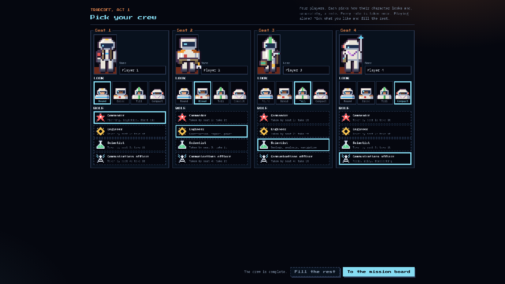
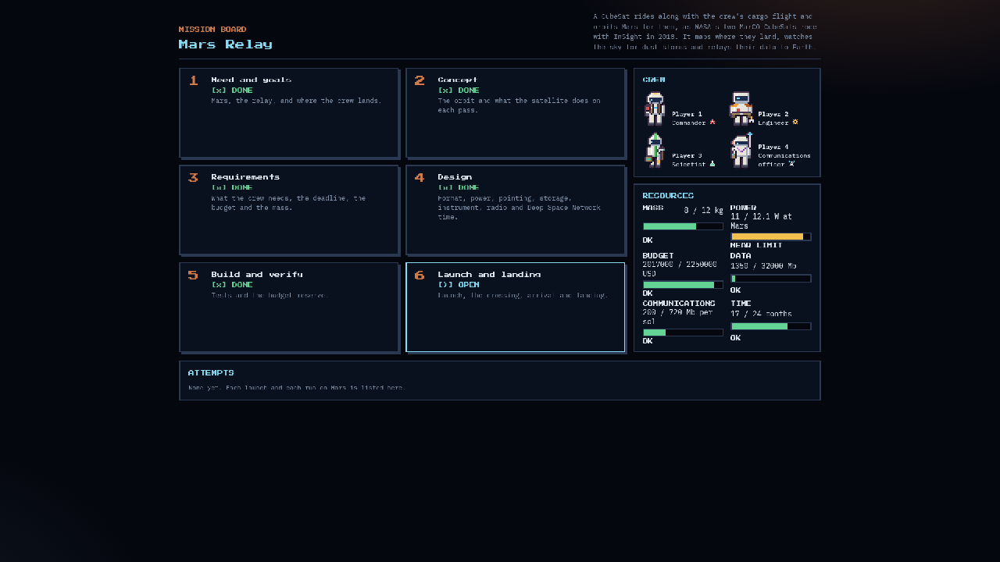
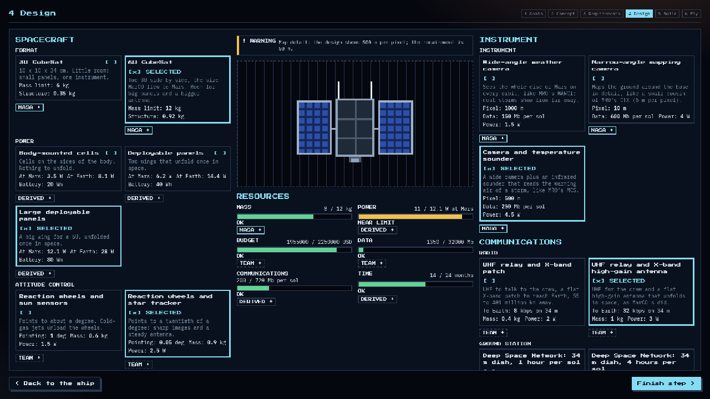
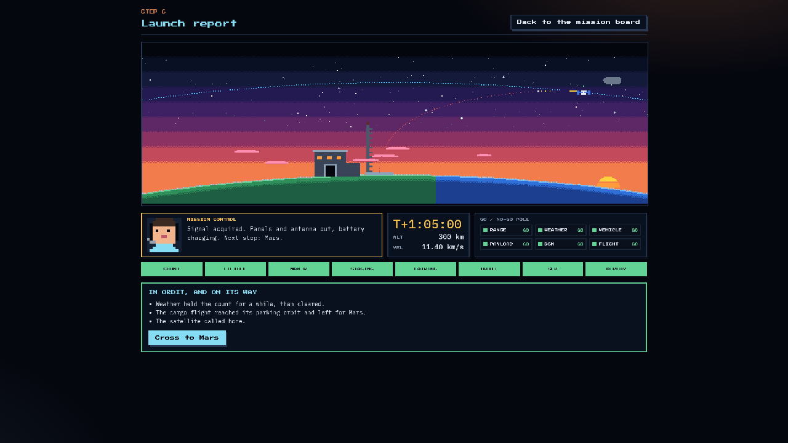
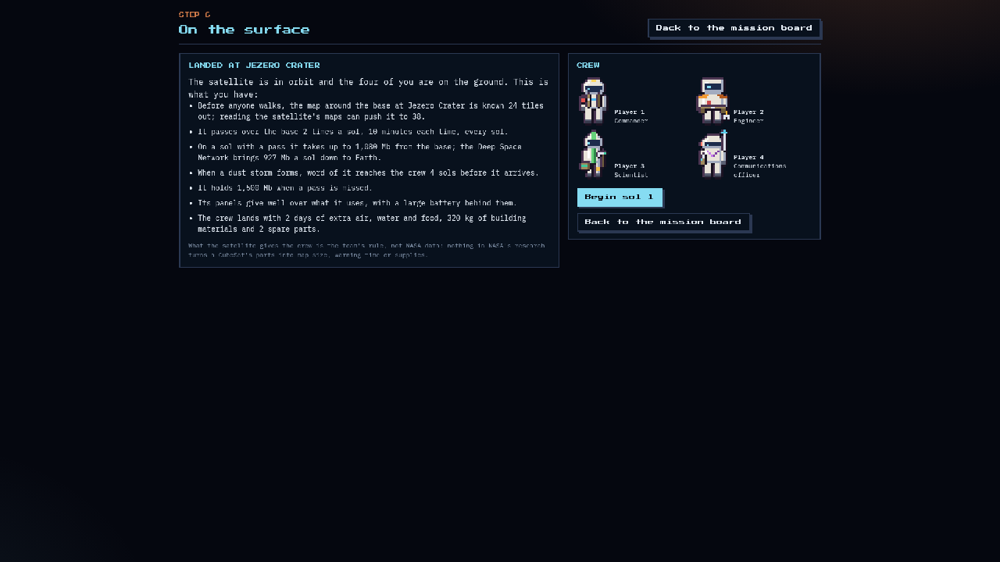
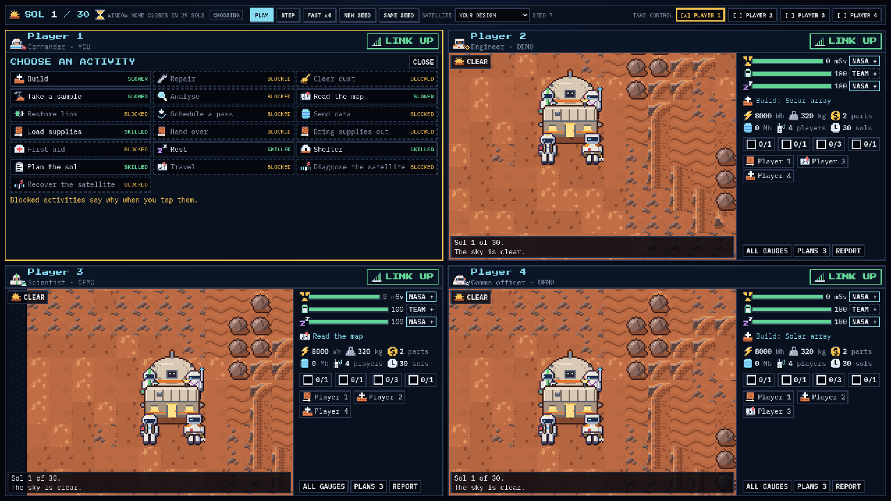
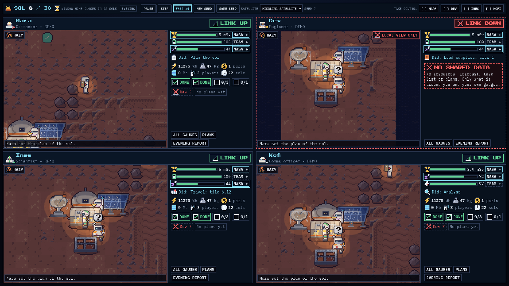
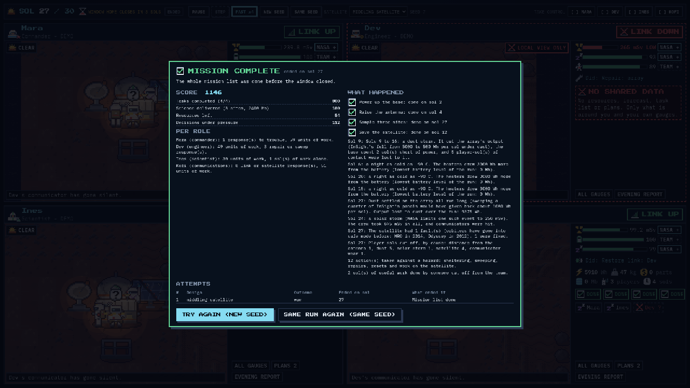

# Tradeoff: user manual

*Every decision made on Earth lands on Mars with you.*

Play it at **https://tradeoff-lapeace.vercel.app**. Nothing to install and no account.

Tradeoff is a game in two acts. In **Act 1** the crew designs a small relay satellite for Mars and launches it.
In **Act 2** the same crew lives 30 sols (Martian days) on the surface with the satellite they designed.

This manual explains what every screen is and how to operate it. It does not say which choices work. The game
gives no odds and no advice while you play: it names the causes in the report at the end of each run, and it
keeps every attempt so you can compare them.

## Contents

1. [What you need](#1-what-you-need)
2. [Act 1: design the satellite](#2-act-1-design-the-satellite)
3. [Step 6: launch, crossing and landing](#3-step-6-launch-crossing-and-landing)
4. [Act 2: 30 sols on Mars](#4-act-2-30-sols-on-mars)
5. [The end of a run](#5-the-end-of-a-run)
6. [Where the numbers come from](#6-where-the-numbers-come-from)
7. [Good to know](#7-good-to-know)

## 1. What you need

- A current web browser on a computer, a tablet or a phone. On a phone the layout changes to one column, and in
  Act 2 the four players become four tabs.
- One to four people. The game is made for four players sharing one screen; one person can play alone and let
  the game fill the other seats.
- Sound is optional.

## 2. Act 1: design the satellite

### Pick your crew

There are four seats. For each seat:

1. Type a **name**.
2. Pick a **look** (Round, Broad, Tall or Compact). The look changes only the drawing.
3. Pick a **role**. Every role is taken once; picking a role another seat holds takes it from that seat.

| Role | Skills |
|---|---|
| Commander | Planning, logistics, first aid |
| Engineer | Construction, repair, power |
| Scientist | Geology, analysis, navigation |
| Communications officer | Radio, relay, forecasting |

**Fill the rest** completes the empty seats for you. **To the mission board** is enabled when the four seats are
ready.

### The mission board

The board is the hub of Act 1. It shows:

- **The six steps**, in order. Each one is LOCKED, OPEN, DONE or PROBLEM. Finishing a step opens the next one.
  A step marked PROBLEM says what is wrong on its card. You can reopen a finished step to change it.
- **The crew** you picked.
- **Resources**: six bars that follow the design as it grows (see below).
- **Attempts**: every launch and every run on Mars, with how it ended.

| Step | What you decide |
|---|---|
| 1. Need and goals | The world (Mars), the mission (Mars Relay) and the region where the crew lands |
| 2. Concept | The orbit of the satellite, and how each pass is shared between watching the sky and relaying data |
| 3. Requirements | What the mission must meet: map detail, storm warning, data per sol, deadline, budget, mass, reserve |
| 4. Design | The satellite's parts |
| 5. Build and verify | Which tests to run and how much budget to keep in reserve |
| 6. Launch and landing | Nothing to choose: you watch what your design does |

### How the decision screens work

- Options are **cards**. Tap a card to select it; `[x] SELECTED` marks the choice. Each card shows its own
  numbers (mass, power, cost and so on).
- In step 3 each requirement has a **slider** and a box for the exact value.
- Some steps hold more than one decision: **Next decision** and **Previous decision** move between them.
- **Finish step** saves the step and returns to the mission board. The button **Back to the ship** also returns
  to the mission board.
- A small tag next to a number says where it comes from: **NASA**, **DERIVED** or **TEAM**. Tap the tag to read
  the source (see section 6).
- A **WARNING** box appears when the design, as it stands, does not meet a requirement you set.

In step 4 the cards are grouped: format (3U or 6U CubeSat), power, attitude control, image storage, instrument,
radio, time on the Deep Space Network, a backup station and the launch. In step 5 each test card says what it
costs, how long it takes and which requirement it verifies; the table under the cards marks each requirement
VERIFIED or NOT VERIFIED.

### The six resources

| Bar | What it measures |
|---|---|
| Mass | Kilograms of the parts and propellant against the limit of the chosen format |
| Power | Watts the parts draw against what the panels give at Mars |
| Budget | Dollars spent against the budget, minus the reserve |
| Data | Megabits the instrument produces against the storage |
| Communications | Megabits per sol the mission needs against what the link carries |
| Time | Months to build and test against the date of the cargo flight |

Each bar reads OK, NEAR LIMIT or OVER LIMIT. A bar reads NOT SET YET until the choices that feed it are made.

## 3. Step 6: launch, crossing and landing

1. **The brief** lists everything that rides with the cargo flight. Press **Start the countdown**.
2. **The launch.** Mission control polls six stations (range, weather, vehicle, payload, Deep Space Network,
   flight). Their answer is final for this attempt. The launch ends in one of three ways: **In orbit**,
   **Scrubbed** (it never left the pad) or **Lost**. The report says what happened.
   - In orbit: press **Cross to Mars**.
   - Scrubbed or lost: **Launch again with this design**, or go **Back to the board to change the design**.
3. **The crossing** takes 272 days and shows the growing radio delay to Earth. There is nothing to decide.
4. **Arrival and landing.** The satellite enters orbit and the lander comes down.
5. **On the surface.** A summary lists what your satellite gives the crew: how much of the map is known, how
   often it passes over the base, how much data it carries, how early it warns of a dust storm, and the
   supplies the crew lands with. Press **Begin sol 1** to start Act 2.

The **Space** bar or **Enter** skips the launch, the crossing and the landing animations. The buttons on screen
do the same.

## 4. Act 2: 30 sols on Mars

### The goal

Finish the mission list before the window to fly home closes, at sol 30:

1. **Power up the base**: build the solar array.
2. **Raise the antenna**: build the antenna.
3. **Sample three sites**: take a sample at each site and send its data to Earth through the satellite.
4. **Save the satellite**: bring it back when it gets into trouble.

The run is lost if the window closes first, if a vital resource runs out, or if nobody is left able to work.

### The screen

The page shows the four players side by side, one panel each. When you open it, all four play by themselves
(the label **DEMO** under each name). A person can take over any of them.

**The top bar**

| Control | What it does |
|---|---|
| SOL n / 30 | The current sol, how many sols are left before the window closes, and the phase of the sol |
| PLAY / PAUSE | Runs or stops the run |
| STEP | Plays one sol and stops |
| FAST x4 | Plays four times faster |
| NEW SEED | Starts again in a different Mars (other weather, other events) |
| SAME SEED | Starts the same run again, to try other decisions |
| SATELLITE | Which satellite the crew has: YOUR DESIGN (the one from Act 1) or three ready-made ones |
| TAKE CONTROL | One switch per player. `[x]` means a person decides for that player |

**One panel** shows, for its player:

- The portrait, the name, the role and the **link** state: LINK UP or LINK DOWN.
- The **map** around the player, with the state of the sky (clear, hazy, storm).
- Three **health gauges**, the ones that are lowest right now. **ALL GAUGES** shows the eight of them:
  radiation dose, energy, rest, air, water, food, body and morale.
- The **activity** chosen for this sol.
- The **shared row** of the base: power stored, building materials, spare parts, data waiting to be sent,
  players in contact and sols left.
- The **mission list** as four boxes, each with its progress.
- The **plans** of the other players for this sol. **PLANS** shows them in full.
- **REPORT**: the briefing of the morning or, after the sol, the evening report.

### How a sol goes

1. **Briefing.** Each player reads what they are able to know this morning.
2. **Choosing.** Each player picks one activity for the sol. The players who play by themselves choose first;
   those in contact see each other's plans and may change theirs (marked CHANGED).
3. **Playing.** The sol plays on the four maps at once.
4. **Evening.** Each panel shows what happened to its player. Then the next sol starts.

### Playing a character yourself

1. Press the player's switch under **TAKE CONTROL**. The panel now says **YOU**.
2. Each sol, the run waits for you. Press **CHOOSE ACTIVITY** (or **CHANGE ACTIVITY**).
3. Pick an activity from the list. If it needs a target (a module, a site, a teammate, a place), pick it next.
4. The sol plays when every controlled player has chosen. **LET THE DEMO CHOOSE** hands this one sol back to
   the game.

Every activity in the list carries one of three words:

- **SKILLED**: it belongs to your role, or it is something everyone can do.
- **SLOWER**: you can do it, but it is not your role's skill.
- **BLOCKED**: it is not possible right now. Tap it and the panel says why.

| Activity | What it is | Skill of |
|---|---|---|
| Build | Work on a base module; uses materials, power and sols | Engineer |
| Repair | Fix the array or a teammate's communicator; uses a spare part | Engineer |
| Clear dust | Sweep dust off the solar array | Engineer |
| Take a sample | Collect rock and soil at a site | Scientist |
| Analyse | Turn a sample into data ready to send | Scientist |
| Read the map | Work the satellite's pictures into more of the map | Scientist |
| Restore link | Bring a teammate's communicator back on the network | Communications officer |
| Schedule a pass | Ask the satellite for a pass over the base tomorrow | Communications officer |
| Send data | Send analysed data up to the satellite during a pass | Communications officer |
| Diagnose the satellite | Read its telemetry to find what is wrong | Communications officer |
| Recover the satellite | Send the commands that bring a diagnosed satellite back | Communications officer |
| Plan the sol | Coordinate the others who are in contact | Commander |
| Load supplies | Load air, water and food for a teammate who will be away | Commander |
| Bring supplies out | Carry supplies to a teammate who is away from the base | Commander |
| First aid | Treat a teammate | Commander |
| Hand over | Give a teammate beside you what you carry | Everyone |
| Travel | Walk to a place on the map | Everyone |
| Rest | A quiet sol: sleep, eat, recover | Everyone |
| Shelter | Stay inside the habitat | Everyone |

### When the link is down

Each player carries a communicator, and on Mars it can fail. A player with **LINK DOWN**:

- sees **only what is around them** on the map (LOCAL VIEW ONLY) and their own gauges;
- has **no shared data**: no resources of the base, no forecast, no mission list, no plans of the others;
- still chooses an activity every sol, alone.

The other players see that teammate with a question mark: no contact, plan unknown. When the link returns, the
panels announce that the player **IS BACK** and show what they did while they were alone.

### What Mars does

Five things happen on the surface during a run: dust storms, cold nights, dust settling on the solar array,
solar storms and faults in the satellite. When the satellite is able to warn of one, the warning appears in the
shared row of the players in contact.

## 5. The end of a run

When the run ends, a report covers the screen:

- **MISSION COMPLETE** or **MISSION LOST**, the sol it ended on and the reason.
- **Score**, in four parts: tasks completed, science delivered, resources left and decisions under pressure.
  A line per role says what each player did.
- **What happened**: each task of the mission list, and the causes, sol by sol. This is the only place where
  the game explains why.
- **Attempts**: the last runs, with the satellite each one used and what ended it.

**TRY AGAIN (NEW SEED)** starts a new run in a different Mars. **SAME RUN AGAIN (SAME SEED)** replays the same
Mars so you can decide differently. To change the satellite, go back to the design (the home page) and launch
again, or pick another one under SATELLITE.

## 6. Where the numbers come from

Every number on screen carries a tag:

- **NASA**: a published NASA figure. The tag opens the source (for example the Mars Fact Sheet, the Mars Relay
  Network handbook, or the row of the project's data table).
- **DERIVED**: computed from NASA figures. The tag shows how.
- **TEAM**: a game-balance value chosen by the team. It is illustrative, not a NASA figure.

The rule that turns a satellite design into what the crew gets on the surface (map size, warning time,
supplies) is the team's: nothing in NASA's research turns a CubeSat's parts into those. The game says so on
the landing summary. The full list of sourced numbers is in `Resources/10-mars-surface/` of the repository.

## 7. Good to know

- **Saved in your browser.** The list of attempts and the design handed to Act 2 are kept in the browser you
  play in. Another browser or device starts empty.
- **Reloading the design page** starts Act 1 again from the crew screen. The attempts are kept.
- **Opening Act 2 directly** (`/mars.html`) works without designing: pick one of the ready-made satellites
  under SATELLITE.
- **Back to the ship.** The decision screens of steps 1 to 5 keep this button name from an earlier version of
  the game. It returns to the mission board.
- **Four players, one screen.** Each player has a panel, but this version runs in one page: there is no
  online play between devices yet.
